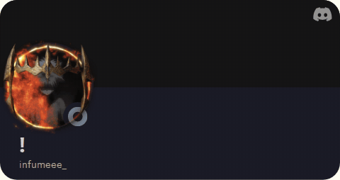

# Animated Discord card for uzi-090

This is a small starter project that **converts the animated Discord profile SVG**
from [the-snesler/discord-github-readme](https://github.com/the-snesler/discord-github-readme)
into a normal **GIF** so animations can play inside your GitHub README.

It does **not** modify your existing pixel-room GIF. Place the new card below it.

## Prerequisite

Join the original project's Discord server so its bot can read your Discord status:
https://github.com/the-snesler/discord-github-readme (follow its join-server link).
In that server's privacy settings, enable activity sharing if you want games/Spotify.
The original service must return a working profile card for your user ID.

## Installation

1. Open your profile repo: https://github.com/uzi-090/uzi-090
2. Upload the `.github/workflows/discord-card.yml`, `scripts/render_card.py`, and
   `requirements.txt` files from this package, preserving folder names. GitHub's
   web UI supports dragging folders into **Add file → Upload files**.
   You can also create the files manually if folder upload doesn't work.
3. In **Actions**, click **Update animated Discord card → Run workflow**.
4. Check for a green check. A generated file will appear at
   `assets/discord-card.gif` in your `main` branch.
5. Put this *after* your current pixel-room GIF in `README.md`:

```html
<p align="center">
  <a href="https://discord.com/users/737953430051618839">
    
  </a>
</p>
```

## Configuration

- To change user: edit `DISCORD_USER_ID` in the workflow.
- To change colors: edit `--theme tokyoNight` (options in original project README).
- To change FPS: `--fps 20` (up to 30; higher is more CPU / larger GIF).
- To change duration: `--seconds 5` (up to 12 seconds).
- Workflow runs every **2 hours**, may be delayed, and GitHub caches image URLs.
  This is an animated snapshot of your Discord info, **not live status**.
- Animation only appears where the original service actually supplies animated assets.
- If the service is unavailable or doesn't know your Discord ID, the Action fails.
- Large or complicated profile cards may make large GIFs.

## Limitations

The original project outputs an SVG and says to use `<object>` for animated
avatars/banners/decorations. GitHub READMEs do not permit `<object>`.
This project uses a headless browser to render the SVG inline in a document,
then captures frames and encodes a GIF. It does not reuse the original source
code, only the public hosted service's output.

The GitHub Action commits to `main`, not to `output`, so it won't overwrite the
`output` branch used by contribution snake workflows. GitHub may cache the file
and delay updates. The external hosted service is not under your control.
