<picture>
  <source media="(prefers-color-scheme: dark)" srcset="./assets/adhd-hero-dark.svg">
  
</picture>

<b>Uzair</b> · &gt;Just VibeCoding

  Swift · ★ 1

<picture>
  <source media="(prefers-color-scheme: dark)" srcset="./assets/adhd-end-dark.svg">
  
</picture>

